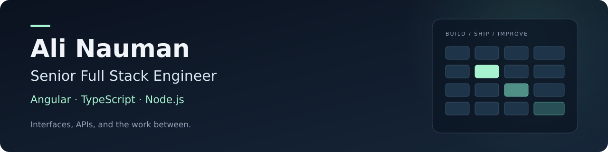

  <strong>Utrecht, Netherlands 🇳🇱 · 8+ years building software</strong> 
  <a href="https://www.linkedin.com/in/alinauman1/">LinkedIn</a> ·
  <a href="mailto:ali60351@gmail.com">Email</a> ·
  <a href="https://github.com/Ali60351?tab=repositories">Repositories</a>

I build B2B products with complex interfaces and the APIs behind them. At **Fashion Cloud**, I work on **ordering and replenishment** across Angular/TypeScript frontends and Node.js services backed by MongoDB and Elasticsearch.

I'm interested in **senior full stack and frontend engineering opportunities in the Netherlands**, especially teams where I can own work from product requirements through production.

## 🧩 Selected work

- **Multi-store replenishment:** Owned Angular UI and Node.js API work for auto-restock, taking the workflow from feature-flagged development through general availability. Led the schedule replenishment project with explicit active, paused and inactive states.
- **Shared size matrices:** Centralized logic used by ordering and replenishment for waist/length, letter and plus sizes, prepacks, and translated validation.
- **Brand page builder:** Co-built a multilingual builder, contributing drag-and-drop editing, asset uploads, previews and supporting APIs.
- **Security and performance:** Moved authenticated image loading from query-string tokens to Authorization headers with client-side blob caching. Removed repeated catalog-access lookups from a products API.
- **Production reliability:** Added hourly monitoring for replenishment orders that failed to export, using AWS EventBridge, Slack alerts and Terraform.

## 🛠️ Tools I work with

| Area | Technologies |
| --- | --- |
| Frontend | Angular, TypeScript, RxJS |
| Backend & data | Node.js, Express, MongoDB, Elasticsearch |
| Production | AWS (S3, EventBridge), Terraform |
| Earlier product work | React, Redux, Django, PostgreSQL |

## 🤖 How I work with AI

I use AI agents to accelerate planning and implementation. I wrote custom skills that compare tickets with product requirements, Figma designs and API contracts, surfacing gaps and recommending decisions before coding begins.

## Previously at Arbisoft

From **2018 to 2022**, I worked on recruitment, e-commerce and internal operations products. I built most of the React frontend for **Hirestream**, an applicant-tracking system, including authentication, rich-text editing, OAuth integrations, live feedback and Stripe payments. I also worked on **Unstack's** Shopify landing-page platform and **Workstream's** internal ERP.

## 🌱 From the workshop

**[Material RTE](https://github.com/Ali60351/material-rte)** — A React/TypeScript rich-text editor built on Draft.js and styled with Material UI, with custom themes, variables and hyperlinks. [View the npm package →](https://www.npmjs.com/package/material-rte)

A few earlier projects

- **[Seiyuu Nostalgia](https://github.com/Ali60351/seiyuu-nostalgia)** — Explore voice-actor connections across anime you've watched. Vue and GraphQL.
- **[Image Processing API](https://github.com/Ali60351/image-processing-api)** — Image resizing and conversion with Sharp, Express and TypeScript.
- **[Quick-FIV](https://github.com/Ali60351/Quick-FIV)** — A desktop file-integrity checker built with Node.js, Electron and Vue.
- **[Warframe Alerts](https://github.com/WFCD/warframe-alerts-win)** — Earlier desktop work with C# and Windows Forms.

---

**Education:** B.S. in Computer Science, FAST National University (2014–2018)  
**Languages:** English, Urdu
